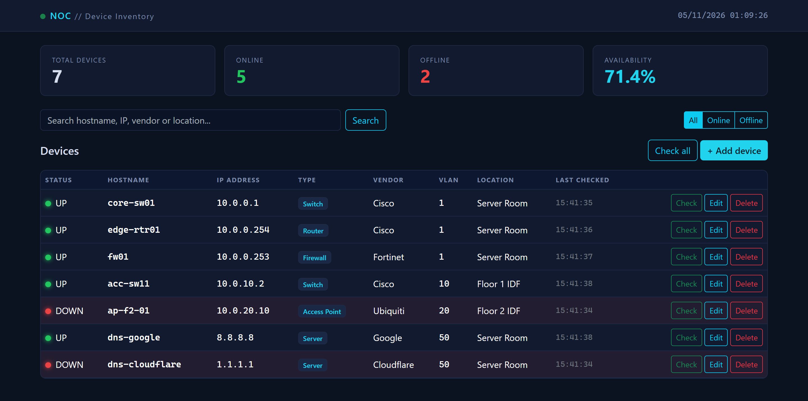
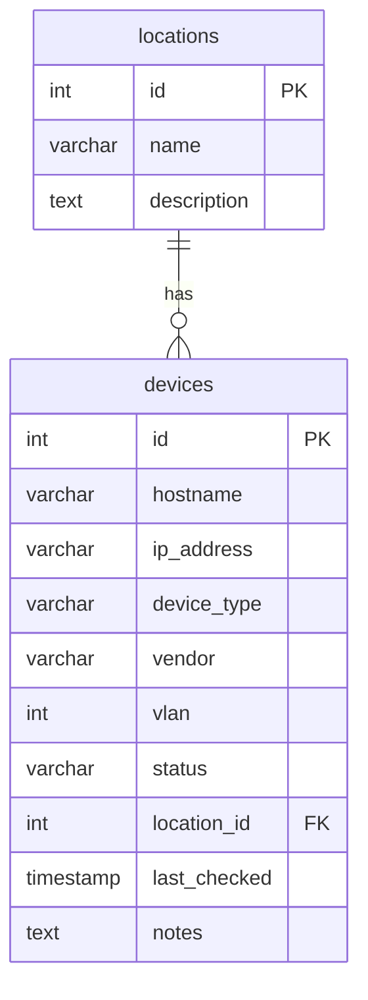
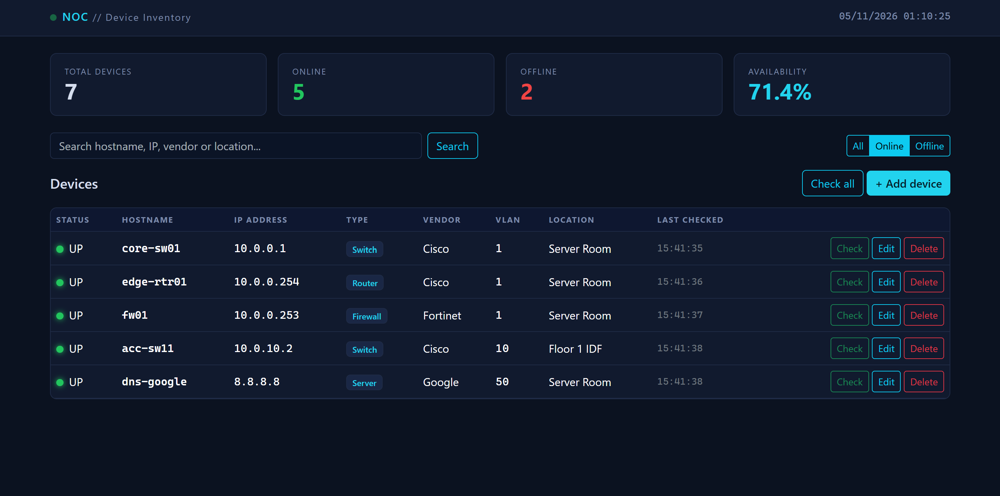
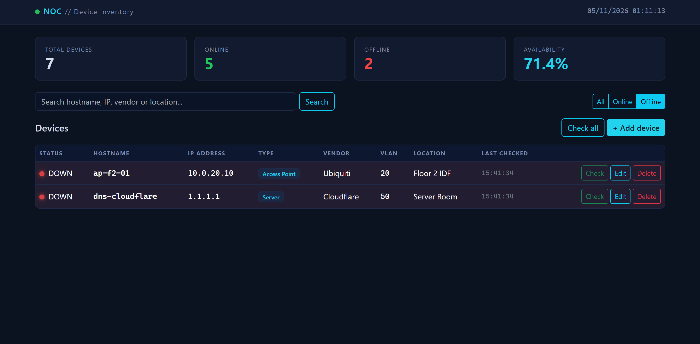
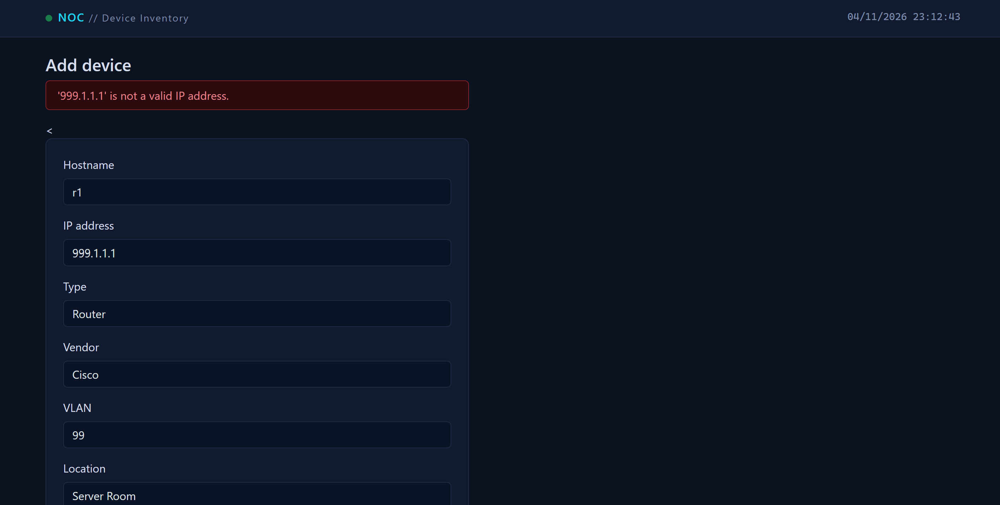
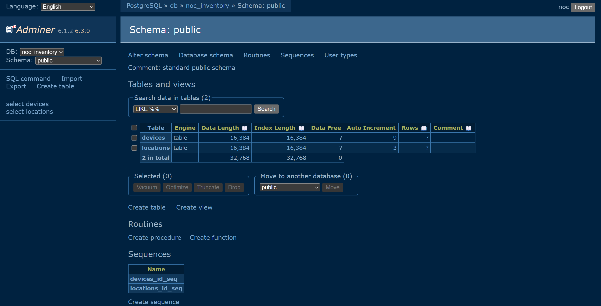
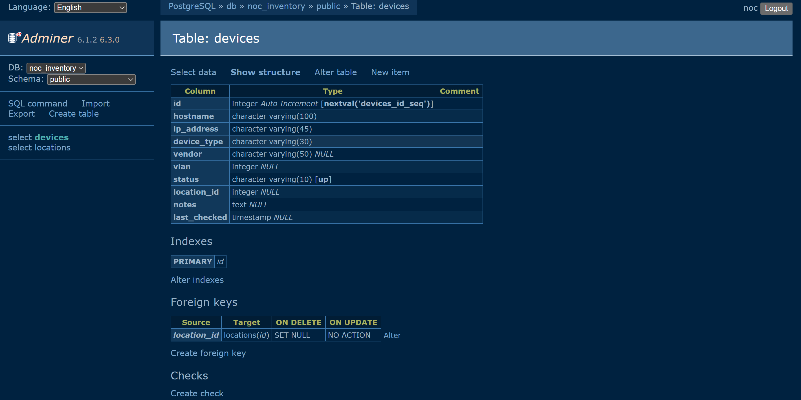
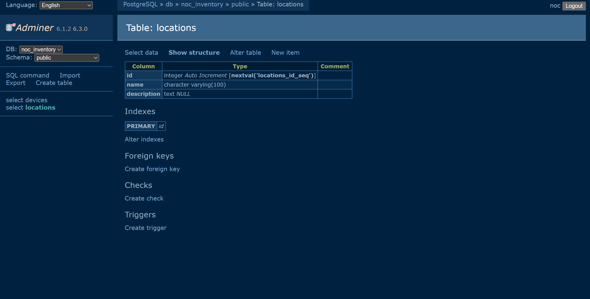

# NOC Device Inventory

A web app for managing network devices (routers, switches, firewalls, access points, servers) in a NOC-style dashboard. It was built for a container course and runs entirely on Docker Compose.



## Features

- **CRUD:** add, view, edit and delete devices
- **Dashboard:** live counts for total, online and offline devices, plus availability percentage
- **Status check:** ping a single device or all of them, with a last-checked timestamp
- **Search and filter:** search by hostname, IP, vendor or location, and filter by Online / Offline
- **Validation:** rejects invalid IPv4/IPv6 addresses, duplicate IPs, and VLAN IDs outside 1-4094
- **Database tool:** Adminer included for browsing and editing data directly
- **Persistent storage:** PostgreSQL data lives in a named Docker volume

## Tech stack

| Layer | Technology |
|---|---|
| Web app | Python 3.12, Flask, Gunicorn |
| Frontend | Jinja2 templates, Bootstrap 5 (dark NOC theme) |
| Database | PostgreSQL 16 |
| DB management | Adminer |
| Deployment | Docker, Docker Compose |

## Architecture

Three containers and one volume, started from a single `docker-compose.yml`:

| Service | Image | Host port | Purpose |
|---|---|---|---|
| `web` | built from `./web` | 5000 | Flask app served by Gunicorn |
| `db` | `postgres:16` | not exposed | Database, with healthcheck |
| `adminer` | `adminer` | 8082 | Database management UI |

- `pgdata` (named volume) stores the database files, so data survives `docker compose down`.
- `db/init.sql` creates the tables and loads sample data the first time the volume is empty.
- `web` waits for `db` to be healthy before starting.
- All services use `restart: unless-stopped`.

## Database design



One location can hold many devices. If a location is deleted, its devices stay and their `location_id` becomes `NULL` (`ON DELETE SET NULL`).

## Quick start

```bash
git clone https://github.com/Lattawit/noc-inventory.git
cd noc-inventory
docker compose up -d --build
```

Wait about 15 seconds for the healthchecks, then open:

- **App:** http://localhost:5000
- **Adminer:** http://localhost:8082

Adminer login:

| Field | Value |
|---|---|
| System | PostgreSQL |
| Server | `db` |
| Username | `noc` |
| Password | `nocpass` |
| Database | `noc_inventory` |

> If you reach the app through VS Code Remote-SSH port forwarding, use `127.0.0.1` instead of `localhost`.

### Configuration

The defaults above are for demo use only. To use your own credentials, copy the example file and edit it:

```bash
cp .env.example .env
```

### Stop, restart, reset

```bash
docker compose down        # stop; data is kept in the volume
docker compose up -d       # start again
docker compose down -v     # stop AND delete the database volume (full reset)
```

`init.sql` only runs on an empty volume. After changing the schema or credentials, use `down -v` and start again.

## Screenshots

| Online devices | Offline devices |
|---|---|
|  |  |



### Database in Adminer



| `devices` table | `locations` table |
|---|---|
|  |  |

## Project structure

```
.
├── docker-compose.yml
├── .env.example
├── db/
│   └── init.sql          # schema and sample data
├── web/
│   ├── Dockerfile
│   ├── requirements.txt
│   ├── app.py            # routes, validation, ping check
│   └── templates/        # base, index, form
└── docs/
    └── screenshots/
```

## Design decisions

- **PostgreSQL:** a proper relational database with foreign keys, which suits devices belonging to locations.
- **Adminer:** a single small container that works with Postgres and needs no setup.
- **Named volume:** Docker manages the storage location and the data persists independently of the containers.
- **Gunicorn:** Flask's built-in server is for development only.
- **Ping from the app container:** `iputils-ping` is installed in the image so the status check works without extra services.

## Roadmap

- Incidents table with severity and an Open → Acknowledged → Resolved workflow
- Scheduled background checks
- CSV export

## License

See [LICENSE](LICENSE).